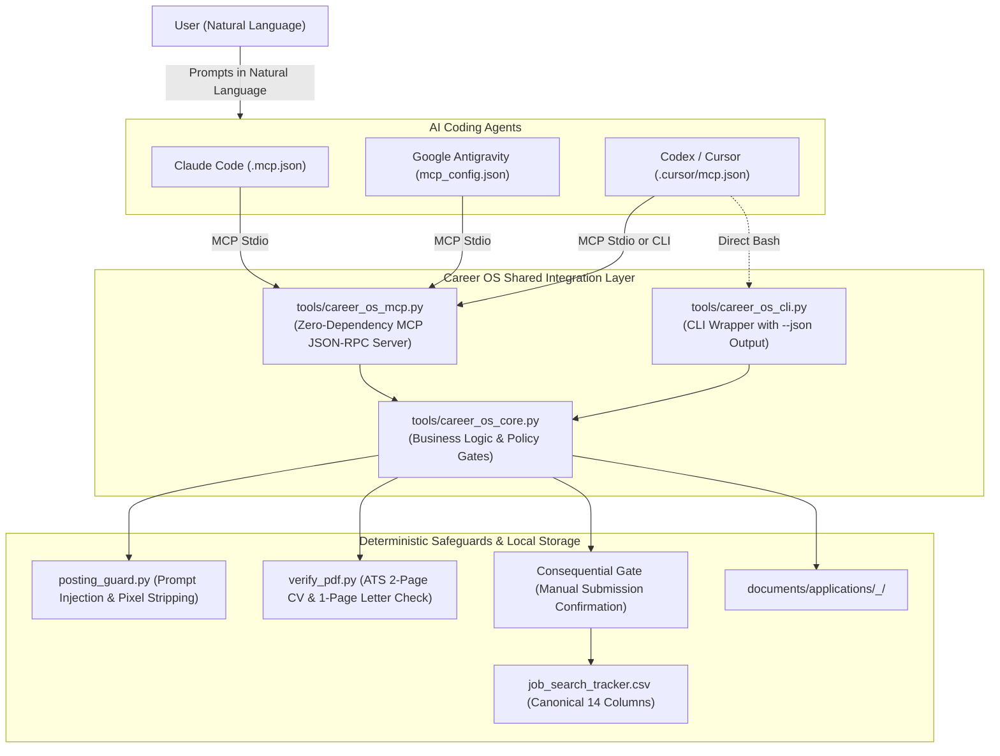

# Agentic Career OS

[](https://www.python.org/downloads/)
[](https://modelcontextprotocol.io/)
[](https://opensource.org/licenses/MIT)

> **"AI proposes, deterministic code validates and gates, nothing with a real external effect happens without a hard policy check or human approval — fail closed on uncertainty, never fail open."**

An autonomous, local-first job search intelligence and application preparation engine built for AI coding assistants (**Claude Code**, **Google Antigravity**, and **OpenAI Codex / Cursor**). Operated entirely through natural language via the **Model Context Protocol (MCP)**.

---

## Architecture Overview



---

## Key Features

- **Zero-Dependency Model Context Protocol (MCP)**: Native Python 3 standard library implementation over `stdio` (JSON-RPC 2.0). Starts in <50ms with zero pip installations.
- **Draft Isolation Invariant**: Generating application packages drafts files inside isolated directories under `documents/applications/`. **The main tracker is NEVER modified during drafting.**
- **Consequential Action Gate**: Applications are submitted manually by you on employer portals. Tracker logging is strictly blocked until explicit confirmation is provided (`user_confirmed=True`).
- **Automated ATS & Layout Verification**: Validates CVs are **exactly 2 pages** and cover letters are **exactly 1 page** with ATS-readable text layers.
- **Adversarial Prompt-Injection Defense**: Screens job listings for hidden instructions, invisible fonts, CSS concealment, and tracking tokens before model processing.
- **Universal Multi-Agent Compatibility**: Works out of the box with Claude Code, Antigravity, and Cursor.

---

## Quickstart

### 1. Clone the Repository
```bash
git clone https://github.com/0merUfuk/agentic-career-os.git
cd agentic-career-os
```

### 2. Connect Your Preferred AI Agent

#### Claude Code
Claude Code automatically discovers [`.mcp.json`](.mcp.json). Simply launch Claude Code in the repo:
```bash
claude
```

#### Google Antigravity
Add the server to your Antigravity configuration in `~/.gemini/config/mcp_config.json`:
```json
{
  "mcpServers": {
    "career-os": {
      "command": "python3",
      "args": ["/path/to/agentic-career-os/tools/career_os_mcp.py"]
    }
  }
}
```

#### Cursor / Codex
Open the repository in Cursor — the pre-configured [`.cursor/mcp.json`](.cursor/mcp.json) loads automatically.

---

## Natural Language Operations

Talk to your agent naturally:

- **Check Status**:
  > *"What is the current status of my job search workspace?"*
- **Evaluate a Job Posting**:
  > *"Analyze this Senior AI Engineer posting at Acme: [paste URL or text]"*
- **Draft Application Package**:
  > *"Draft an application package for Acme as an AI Engineer."*
- **Record Actual Submission**:
  > *"I just submitted the application manually on Acme's career site, please log it."*
- **Interview Preparation**:
  > *"I have an interview with Acme next week. Give me talking points and reverse interview questions."*

---

## Testing

Run the included test suite verifying MCP protocol compliance, ATS checks, and safety invariants:
```bash
python3 -m unittest discover -s tests -t .
```

---

## License

This project is licensed under the [MIT License](LICENSE).
