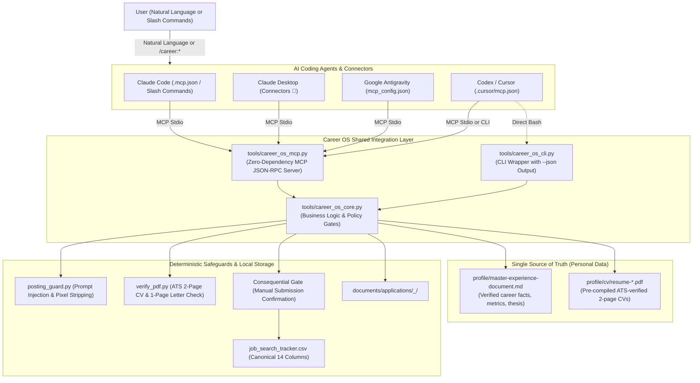

# Agentic Career OS

[](https://www.python.org/downloads/)
[](https://modelcontextprotocol.io/)
[](https://opensource.org/licenses/MIT)

> **"AI proposes, deterministic code validates and gates, nothing with a real external effect happens without a hard policy check or human approval — fail closed on uncertainty, never fail open."**

An autonomous, local-first job search intelligence and application preparation engine built for AI coding assistants (**Claude Code**, **Claude Desktop**, **Google Antigravity**, and **OpenAI Codex / Cursor**). Operated entirely through natural language or direct slash commands via the **Model Context Protocol (MCP)**.

---

## Architecture Overview



---

## Key Features

- **60-Second Setup Wizard (`python3 init.py`)**: One interactive command configures your profile, copies ATS-ready CV templates, and configures Claude Code, Claude Desktop, Cursor, and Antigravity.
- **Zero-Dependency Model Context Protocol (MCP)**: Native Python 3 standard library implementation over `stdio` (JSON-RPC 2.0). Starts in <50ms with zero pip installations.
- **Where Personal Data Lives (Single Source of Truth)**:
  - Career facts, metrics, titles, and stories live strictly in `profile/master-experience-document.md`.
  - Verified 2-page CVs live in `profile/cv/`.
  - Agents read from these documents; they never guess, fabricate, or hallucinate credentials.
- **Draft Isolation Invariant**: Generating application packages drafts files inside isolated directories under `documents/applications/`. **The main tracker is NEVER modified during drafting.**
- **Consequential Action Gate**: Applications are submitted manually by you on employer portals. Tracker logging is strictly blocked until explicit confirmation is provided (`user_confirmed=True`).
- **Automated ATS & Layout Verification**: Validates CVs are **exactly 2 pages** and cover letters are **exactly 1 page** with ATS-readable text layers (`verify_pdf.py`).
- **Adversarial Prompt-Injection Defense**: Screens job listings for hidden instructions, invisible fonts, CSS concealment, and tracking tokens before model processing (`posting_guard.py`).
- **Claude Code Plugin & Slash Commands**: Ships with pre-configured slash commands (`/career:status`, `/career:eval`, `/career:draft`, `/career:log`, `/career:interview`).

---

## 60-Second Quickstart

### 1. Clone the Repository
```bash
git clone https://github.com/0merUfuk/agentic-career-os.git
cd agentic-career-os
```

### 2. Run the Onboarding Wizard
```bash
python3 init.py
```

The wizard will:
1. Ask for your name, email, target role tracks, and career thesis.
2. Initialize your private `profile/master-experience-document.md` and template CVs.
3. Automatically configure MCP connections for Claude Code (`.mcp.json`), Cursor (`.cursor/mcp.json`), and Claude Desktop (`claude_desktop_config.json`).
4. Run self-tests to ensure 100% test passing.

---

## AI Agent Integration

### Option A: Claude Code (CLI)
Claude Code automatically discovers [`.mcp.json`](.mcp.json) and `.claude/commands/`. Simply launch Claude Code in the repo:
```bash
claude
```

You can use natural language or direct slash commands:
- `/career:status` — Inspect pipeline stages, pending drafts, and profile paths.
- `/career:eval <url_or_text>` — Audit and evaluate a job posting for fit and security.
- `/career:draft <company> <role>` — Draft tailored 2-page CV and 1-page cover letter.
- `/career:log <company> <role>` — Record a manual application submission with safety gate.
- `/career:interview <company>` — Generate company battle cards and STAR stories.

### Option B: Claude Desktop (UI Connectors 🔌)
`init.py` automatically registers Career OS with Claude Desktop. If adding manually, add this to your `claude_desktop_config.json`:
- **macOS:** `~/Library/Application Support/Claude/claude_desktop_config.json`
- **Windows:** `%APPDATA%\Claude\claude_desktop_config.json`

```json
{
  "mcpServers": {
    "career-os": {
      "command": "python3",
      "args": ["/ABSOLUTE/PATH/TO/agentic-career-os/tools/career_os_mcp.py"]
    }
  }
}
```
Restart Claude Desktop. In any conversation, click the **🔌 (Connectors / Tools)** icon to see the Career OS tools ready for direct execution.

### Option C: Cursor / Codex
Open the repository in Cursor — the pre-configured [`.cursor/mcp.json`](.cursor/mcp.json) loads automatically.

### Option D: Google Antigravity
Add to `~/.gemini/config/mcp_config.json`:
```json
{
  "mcpServers": {
    "career-os": {
      "command": "python3",
      "args": ["/ABSOLUTE/PATH/TO/agentic-career-os/tools/career_os_mcp.py"]
    }
  }
}
```

---

## Where Agents Look for Your Personal Information

Career OS enforces a strict **Single Source of Truth** architecture:

1. **`profile/master-experience-document.md`**:
   The permanent, authoritative knowledge base for all candidate experience. Contains:
   - Candidate positioning, summary, and core career thesis.
   - Verified production work history with exact dates, titles, and metrics.
   - Technical competencies, open-source projects, and STAR interview stories.
   *Agents read this file to tailor cover letters and evaluate qualifications. If a skill or metric is not here, the agent is forbidden from claiming it.*

2. **`profile/cv/`**:
   Directory containing pre-compiled, verified PDF resumes (e.g. `resume-ai-systems.pdf`).
   - When an application package is drafted, the agent copies your curated PDF directly into the application folder.
   - It validates that the PDF is **strictly 2 pages** using `verify_pdf.py`.

3. **`documents/applications/<company>_<role>/`**:
   The isolated destination directory for each draft:
   - `cv.pdf` (Verified 2-page CV)
   - `cover-letter.pdf` (Tailored, verified 1-page letter)
   - `job-posting.md` (Sanitized posting snapshot)
   - `notes.md` (Tailored highlights and interview talking points)

4. **`job_search_tracker.csv`**:
   The central status tracker. Applications are **never** logged here during drafting. Only when you manually submit on the employer portal and confirm does the agent record the consequential action.

---

## MCP Tools Reference

| Tool | Purpose | Key Invariant |
| :--- | :--- | :--- |
| `career_os_status` | Status, pipeline counts, profile health | Read-only inspection |
| `career_os_evaluate_posting` | Audit posting, sanitize pixels, fit score | Strips prompt injections & ad pixels |
| `career_os_draft_application` | Generate CV & tailored cover letter | Isolated from tracker; verifies page counts |
| `career_os_record_submission` | Record manual submission to tracker | Requires explicit `user_confirmed=True` |
| `career_os_interview_prep` | Technical battle cards & STAR mapping | Grounded in Master Experience Document |
| `career_os_salary_lookup` | Compensation benchmark lookup | Read-only salary data lookup |

---

## Testing

Run the full test suite verifying MCP protocol compliance, ATS checks, and safety invariants:
```bash
python3 -m unittest discover -s tests -t .
```

---

## Contributing & Privacy Notice

This open-source template uses generic sample data (`Alex Vance`) and relative paths. When running `python3 init.py`, your personal `profile/` directory and `job_search_tracker.csv` are created locally and are **automatically excluded from git** via `.gitignore`. Your personal data never leaves your local machine.

---

## License

This project is licensed under the [MIT License](LICENSE).
